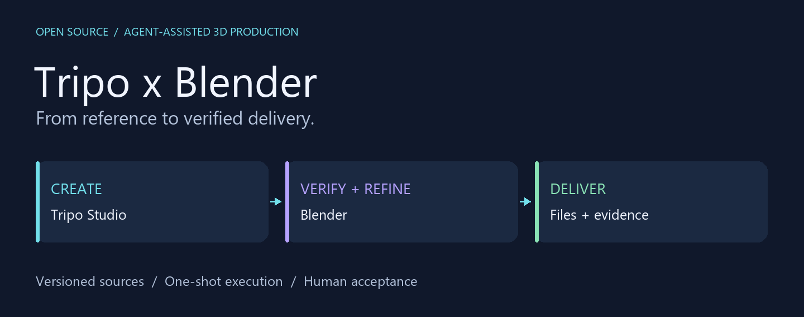
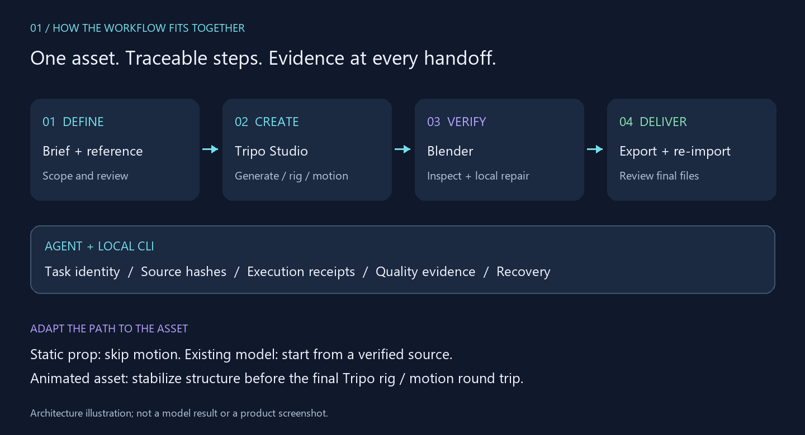
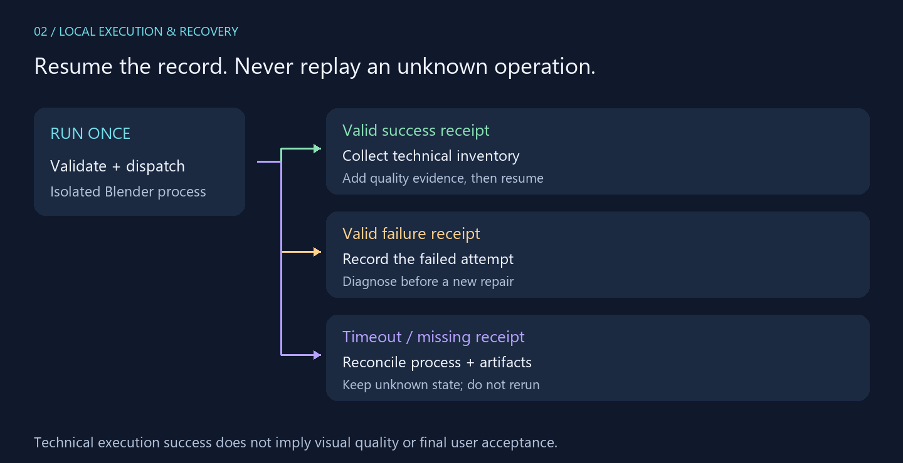

<div align="center">

# Tripo × Blender Workflow

**让 AI 生成的 3D 资产，走完可追溯、可恢复、可验收的制作流程。**

An agent-assisted pipeline for Tripo Studio and Blender — from reference to verified delivery.

[](LICENSE)
[](tools/workflow/PRODUCTION.md)
[](#环境要求)
[](docs/validation/release-validation.md)

[快速开始](#快速开始) · [工作流](#工作流) · [使用示例](#使用示例) · [中断恢复](#中断与失败怎么处理) · [常见问题](#常见问题)

[操作手册](docs/workflow/operator-guide.md) · [技能说明](SKILLS.md) · [贡献指南](CONTRIBUTING.md)

</div>

---

## 这个项目解决什么问题

生成一个模型只是制作过程的一步。真正使用它，还需要确认来源、检查几何和材质、验证绑定与动作、处理返工，并确保导出的文件可以重新打开。

这个项目把这些步骤组织成一个 **代理辅助的单资产工作流**：Tripo Studio 承担主要生成、绑定与原生动作；Blender 负责验证、必要局部修正和交付检查；本地 CLI 管理状态、执行记录与质量证据。

适合通过 AI 编程代理协作制作游戏资产、角色原型或静态模型，并希望保留完整制作依据的开发者与创作者。

## 默认只走三步

**制作 → 自动检查与必要修正 → 最终验收。** 中间审阅、动画节奏检查、补报告和可恢复问题由代理处理，不再逐阶段请求继续。只有真实缺失的设计输入、访问问题、范围变更和最终验收需要用户参与。已有有效参考和授权直接复用。

新任务默认启用；旧任务可凭已有指令执行 `work.mjs simplify`，保留历史和有效验收。详见 [简洁模式与旧任务切换](docs/workflow/concise-mode.md)。

## 先判断是否适合你

| 你的目标 | 建议入口 | 需要注意 |
|---|---|---|
| 从参考图制作静态道具 | 需求与参考 → Studio → Blender 核验 → 交付 | 跳过绑定与动画阶段 |
| 制作带骨骼和动作的角色 | 总控技能 + 绑定动作流程 | 先稳定结构，再做最后一次 Tripo 绑定与动作往返 |
| 已有模型，需要检查或精修 | 归档已有来源 → 对应质量关卡 | 先确认来源与版本，复用合格结果 |
| 中断后继续制作 | `work.mjs summary ASSET` | 按记录恢复；不要重新生成或重新运行未知操作 |
| 将资产接入游戏引擎 | 引擎阶段技能 + 指定目标项目 | 需要实际目标项目验证；仅导出文件不等于已接入引擎 |

> **这是面向 AI 代理和操作者的制作工具链。** 使用方式是“代理读技能、调用工具、保存记录，你完成必要审阅”，不是安装后点击一个按钮即可自动产出合格模型的独立应用。

## 核心能力

| 能力 | 实际行为 |
|---|---|
| **明确的资产身份** | 记录候选、源版本、文件哈希和标准，避免选错模型或借用过期证据 |
| **一次执行，可恢复** | 独立后台运行 Blender，保存日志和回执；恢复只对账，不重复执行未知操作 |
| **按缺陷控制返工** | 同一缺陷连续无改善时要求诊断与方法变化，不能只换策略编号继续 |
| **证据驱动的质量关卡** | 区分技术检查、视觉审阅和最终验收；运行成功不自动变成质量通过 |
| **按需复用检查** | 属性依赖和实际指纹足够时复用证据；不支持或已变化的部分重新验证 |
| **九个阶段技能** | 从需求与参考到 Studio 制作、Blender 修正、引擎接入和交付，按目标调用 |

## 工作流



*流程示意图，不是模型成品展示。图中各阶段按任务需求启用；局部修正后仍需重新核验。*

### 三个部分如何配合

| 部分 | 负责什么 | 产出什么 |
|---|---|---|
| Tripo Studio | 网页生成、适用的原生处理、绑定与动作 | 可定位到具体任务和版本的远程结果 |
| Blender | 检查模型、必要局部修正、导出和回读 | 可编辑母版、交换文件与检查证据 |
| AI 代理 + 本地 CLI | 将需求转成阶段计划，执行和核对记录 | 来源关联、执行回执、质量报告和下一步指引 |

### 需要绑定或动画时

对于需要结构修正和新增动作的资产，采用以下顺序：

**必要结构修正 → 稳定交换副本 → Tripo 绑定/动作 → 导回检查 → 最终权重、材质与动作精修 → 正式导出。**

已有合格结果直接复用。静态资产跳过动作步骤；纯绑定任务不要求制作动画。详见 [往返规范](docs/workflow/roundtrip.md)。

## 环境要求

| 组件 | 用途 | 要求 |
|---|---|---|
| Node.js | CLI、状态管理与测试 | 推荐 22 或更新版本 |
| Python | 独立检查脚本 | Python 3 |
| Blender | 后台执行、采样、修正与验证 | 可运行的本地安装，显式指定可执行文件 |
| 支持工具调用的 AI 代理 | 解释需求、操作 Studio、组织证据与审阅 | 技能和工具接入按宿主配置 |
| Tripo Studio 会话 | 网页生成与后处理 | 自有账户；操作时检查当前功能和报价 |
| Playwright MCP | 代理操作 Studio 网页 | 可选依赖，按 [接入说明](PLAYWRIGHT_SETUP.md) 配置 |

核心工作流 **没有第三方 Node 依赖**。后台 Blender 路径不依赖实时 Blender MCP；需要实时场景控制或 DCC Bridge 时，另行配置并验证连接。

发布验证环境：Windows、Node.js 26.8.2、Python 3.13.13、Blender 5.2.0 LTS。其他版本与平台需在目标环境运行验证，见 [发布记录](docs/validation/release-validation.md)。

## 快速开始

### 开始前准备

- 一份明确需求：资产用途、静态或动画、目标格式、需要保留的特征；如需引擎接入，提供目标项目。
- 自己有权使用的参考图或已有模型，以及可用的 Tripo Studio 会话。
- 能调用终端与所需浏览器工具的 AI 代理；技能安装见下文，网页工具见 [Playwright 接入说明](PLAYWRIGHT_SETUP.md)。
- 本机 Node.js、Python 与 Blender。先通过本地环境检查，再开始制作。

下面命令从仓库根目录运行。`my-asset` 是示例资产名；Blender 路径和请求文件需要替换成自己的实际值。

### 1. 获取源码

```bash
git clone https://github.com/ZDB932-ai/tripo-blender-workflow.git
cd tripo-blender-workflow
```

查看命令与已有任务：

```bash
node tools/workflow/work.mjs --help
node tools/workflow/work.mjs list
```

### 2. 验证本地环境

以下以 PowerShell 为例，将路径替换为自己的 Blender 安装位置：

```powershell
$blenderExe = 'C:/path/to/Blender/blender.exe'
node tools/workflow/doctor.mjs --profile local --blender $blenderExe
node tools/workflow/validate.mjs --blender $blenderExe --report docs/validation/my-check-raw.json
```

`validate` 会运行包含真实 Blender 夹具的完整测试；缺少 Blender 时失败，不静默跳过。报告文件名须未被占用。

### 3. 建立资产任务

```bash
node tools/workflow/scaffold.mjs my-asset
node tools/workflow/work.mjs summary my-asset
```

`scaffold` 只创建草稿，不会生成模型。接下来由你和代理按 [操作者入口](docs/workflow/operator-guide.md) 完成需求、参考审阅、任务范围、质量标准和本地返工配置，再按返回的下一步继续。

可以向已安装技能的代理提出这样的任务：

> 使用 tripo-studio-pipeline，基于我提供的参考制作一个静态道具，交付 GLB 和可编辑 Blender 母版。先检查当前任务与参考，再按工作流完成制作和验证。

### 4. 执行本地操作

任务已经配置、候选模型已经归档，并准备好实际操作脚本与 `work/request.json` 后：

这里的请求和结果文件**不是克隆后自带的通用模板**，应由代理根据当前候选、质量标准和真实操作生成。它们的路径相对 `assets/my-asset/`；不要把示例路径当作已存在的文件。

```powershell
node tools/workflow/run-local.mjs run my-asset work/request.json --blender $blenderExe
```

命令执行一次 Blender 并收集日志、回执和技术清单。准备好基于实际检查的 `work/result.json` 后：

```bash
node tools/workflow/run-local.mjs resume my-asset --result work/result.json
```

`resume` 不会再次运行 Blender。缺少质量资料时保持待补充状态；未知执行先对账。请求、结果与诊断字段见 [本地自动执行](docs/workflow/local-automation.md) 和 [执行协议](tools/workflow/PRODUCTION.md)。

## 使用示例

以下是给代理的任务示例，不是命令行参数。将参考、格式和项目位置替换为真实信息。

### 示例 A：从参考制作静态道具

> 使用 tripo-studio-pipeline，根据我提供的参考制作一个游戏场景道具。它是静态资产，不需要绑定与动画；交付 GLB、可编辑 .blend 和预览图。先明确尺寸、朝向、材质与保留特征，再进入制作。费用沿用本任务已有授权，最终交付前展示实际导出回读结果。

预期路线：参考审阅 → Studio 制作 → 外形与材质核验 → 必要局部修正 → GLB 导出与回读 → 最终审阅。

### 示例 B：继续已有角色的绑定与动作

> 使用 tripo-studio-pipeline，先检查已有角色任务与当前候选。复用已经通过的部分；如需结构修改，先稳定交换副本，再进行 Tripo 绑定和动作处理。最后检查权重、动作节奏和导出回读，并交付母版与约定格式文件。

预期路线取决于已有记录。纯绑定任务跳过动作；新增动作不能覆盖已验收版本。具体见 [绑定与动画审阅](docs/workflow/animation-review.md)。

### 示例 C：恢复中断任务

> 继续资产 my-asset。先读取 summary 和现有日志、回执，判断是等待质量资料、远程对账还是本地对账。复用已有有效授权与成果，完成当前记录后继续下一阶段。

先执行 `node tools/workflow/work.mjs summary my-asset`。缺少质量资料时补报告并 `resume`；提交状态未知时先核实原任务。

## 安装代理技能

仓库包含一个总控与八个阶段技能，须与共享执行器和文档配套使用。

```powershell
# 先预览差异
node tools/workflow/sync-skills.mjs '你的技能安装目录'

# 备份已有文件后同步
node tools/workflow/sync-skills.mjs '你的技能安装目录' --apply
```

总入口为 `tripo-studio-pipeline`。完整职责表见 [SKILLS.md](SKILLS.md)。只需检查、下载或继续已有任务时，不必重新走完整制作流程。

## 常用命令

所有命令均从仓库根目录运行，`ASSET` 替换为资产目录名。

| 目标 | 命令 |
|---|---|
| 查看全部任务 | `node tools/workflow/work.mjs list` |
| 查看下一步与返工建议 | `node tools/workflow/work.mjs summary ASSET` |
| 新建草稿 | `node tools/workflow/scaffold.mjs ASSET` |
| 一次后台执行 | `node tools/workflow/run-local.mjs run ASSET REQUEST.json --blender PATH` |
| 恢复并提交质量结果 | `node tools/workflow/run-local.mjs resume ASSET --result RESULT.json` |
| 检查正式记录 | `node tools/workflow/production.mjs check ASSET` |
| 完整本地验证 | `node tools/workflow/validate.mjs --blender PATH` |

## 修改次数与防止反复返工

新任务默认按实际进展继续，不再因为累计次数用尽反复请求扩额。有改善继续；同一缺陷连续两次无改善先诊断换方法；跨缺陷连续六次无改善停止新增制作，保留最佳候选并报告具体问题。诊断与导出独立处理，质量与验收不放宽。旧任务可按已有授权一次迁移，见 [本地迭代策略](docs/workflow/iteration-policy.md)。

## 中断与失败怎么处理



| 看到的情况 | 下一步 | 完成条件 |
|---|---|---|
| `awaiting_quality_result` | 根据真实检查补齐结果文件，再 `resume --result` | 原执行回执与质量资料通过校验 |
| `reconcile_local` | 检查原 Blender 进程、日志、回执和输出 | 执行身份与实际结果能够对账 |
| `reconcile_remote` | 检查 Studio 原任务和结果版本 | 明确原提交结果，不重复点击生成 |
| 有效失败回执 | 保留失败记录，诊断本轮原因 | 新尝试满足剩余范围和返工规则 |
| 同一缺陷连续无改善 | 查看 `summary.repair_routing`，提供有证据的复盘和新方法 | 满足策略复盘要求，不能只改策略编号 |
| 残留 `.workflow.lock` | 核实原执行者是否仍在运行 | 确认状态后按恢复协议处理 |

`resume` 只恢复和核对已有记录，不会再次启动 Blender。进程退出码、日志或技术清单都不能单独证明资产质量合格。详见 [本地自动执行](docs/workflow/local-automation.md) 与 [恢复协议](tools/workflow/RECOVERY.md)。

## 最终会交付什么

具体文件取决于任务约定，而不是每个任务都强制生成所有格式。

| 交付项 | 用途 | 验收依据 |
|---|---|---|
| 可编辑 Blender 母版 | 后续调整、保留制作成果 | 文件可打开，相关依赖可定位 |
| 约定格式的导出文件 | 交换或目标运行环境使用 | 在干净环境回读，检查尺度、材质及适用的骨骼和动作 |
| 预览与质量证据 | 核对外观、变形和动作表现 | 证据对应当前候选和最终文件版本 |
| 制作与执行记录 | 追溯来源、修改和恢复过程 | 任务身份、哈希、执行回执和报告对应 |
| 引擎验证结果（如要求） | 确认资产在指定项目可用 | 实际项目中的材质、尺度、碰撞及适用动画检查 |

技术检查通过后仍需展示实际成果并记录最终意见。当前仓库提供工具链和验证夹具，**不包含可下载的生产模型作品集**；首页图片均为项目流程示意。

## 积分与审阅

仓库保留原作者的配置偏好：已授权任务范围内自主使用现有 Studio 网页积分，不逐次询问；仍核对报价、余额和未知提交，不自动充值、购买套餐或切换 API。

**克隆仓库不等于获得费用授权。** 原作者的持续授权仅适用于原作者账户。其他操作者应在首次制作前配置自己的 `workflow-policy.json` 和真实授权依据；需要显式费用上限时使用 `explicit_budget` 模式。参见 [积分策略](docs/workflow/credit-policy.md)。

参考审阅和最终验收独立于费用设置；简洁模式的中间与动画节奏审阅由代理基于真实证据完成。

## 测试与验证

```bash
# 规则与状态测试；未设置 BLENDER_TEST_EXE 时会明确跳过真实 Blender 测试
npm test --prefix tools/workflow

# Python 形变保护检查
python tools/workflow/test_deformation_guard.py
```

当前发布基线：**114 项工作流测试通过，0 失败、0 跳过；另有 4 项 Python 检查通过。** 这是本次发布的验证记录，不是持续集成实时状态。

覆盖正常执行、回执核验、源文件保护、失败记录、超时保持未知、恢复不重放、过期证据拦截及跨策略返工规则。完整验证请使用前述 `validate --blender`，详见 [机器可读摘要](docs/validation/release-summary.json)。

## 项目结构

```text
.
├── skills/                  # 总控与八个阶段技能
├── tools/
│   ├── workflow/            # 状态、执行、质量校验、Blender 脚本与测试
│   └── playwright/          # 可选浏览器 MCP 依赖
├── docs/
│   ├── images/              # 首页配图与可重新生成的绘图源文件
│   ├── workflow/            # 当前操作规范
│   ├── validation/          # 发布验证摘要
│   └── research/            # 标明日期的功能研究
├── assets/                  # 本地任务与资产，默认不提交 Git
├── PLAYWRIGHT_SETUP.md      # Studio 会话接入
└── DELIVERY.md              # 交付范围与限制
```

## 当前边界

- 支持代理辅助的单资产、单候选流程；尚无远程批量、多变体及参考批准前 Studio 收费生图适配。
- CLI 不自动点击网页；当前账户功能、页面设置、输入兼容性与报价需要实际核对。
- 后台测试不认证实时 Blender MCP/Bridge 连接，也不证明任意资产的美术、蒙皮或动作质量。
- 技术清单不代替导出回读与质量报告；本地 Python 执行不是安全沙箱。
- 未知操作不自动重放，崩溃残留锁须先核实执行者。

生产模型、浏览器 profile、会话快照、凭据和私人项目记忆不在此仓库中。[交付说明](DELIVERY.md)列出了进一步的适用范围。

## 常见问题

**需要单独配置 Tripo API Key 吗？**

当前生成路径使用 Studio 网页会话与网页积分，不会自动切换 API。浏览器登录和工具接入按 [接入说明](PLAYWRIGHT_SETUP.md) 配置。

**每次使用积分都要确认吗？**

有效授权覆盖的任务范围内不逐次询问。新操作者首次使用需记录自己的授权；用户审阅模型与批准费用是两件不同的事。

**没有实时 Blender MCP，还能执行本地检查吗？**

可以使用独立后台 Blender 路径，显式传入 `--blender`。实时场景控制与 Bridge 需要另外配置和验证；后台可运行不能证明这些连接可用。

**为什么脚本成功了，任务还没有完成？**

脚本成功仅证明执行结束。质量报告、导出回读和最终用户验收仍需完成；`awaiting_quality_result` 表示等待补齐质量资料。

**克隆后为什么没有模型或参考图片？**

`assets/` 是本地工作数据目录，默认不提交 Git。生产素材、账户会话和个人项目记录不随工具链发布。新任务从 `scaffold` 或已有来源归档开始。

**能在 macOS 或 Linux 上运行吗？**

当前发布记录只覆盖 Windows。其他平台需要调整可执行文件与工具路径，并在目标系统运行完整验证；本项目没有宣称这些平台已经通过验收。

**118 项检查通过意味着什么？**

表示发布时 114 项工作流测试与 4 项 Python 检查通过，其中完整验证包含真实后台 Blender 夹具。不代表任意新资产自动合格，也不代表已经验证新资产的在线端到端生产。

## 文档导航

- [首页配图源文件](docs/images/README.md)：图片说明与重新生成方式。
- [操作者入口](docs/workflow/operator-guide.md)：从新任务到交付的实际步骤。
- [本地自动执行与返工](docs/workflow/local-automation.md)：run/resume、技术记录与换路。
- [执行协议](tools/workflow/PRODUCTION.md)：正式状态、质量关卡与数据格式。
- [恢复协议](tools/workflow/RECOVERY.md)：远程未知任务、传输和审阅恢复。
- [Studio 操作配方](docs/workflow/studio-recipes.md)：按目标选择功能。
- [贡献指南](CONTRIBUTING.md)：提交问题、修改与测试约定。

## 开源许可

本项目采用 [MIT License](LICENSE)。欢迎使用、修改和贡献。

第三方软件、服务及依赖保留各自许可与使用条款；本许可证不授予 Tripo 服务使用额度，也不替生成资产决定权利归属。本项目是独立工作流项目，与 Tripo、Blender 官方无隶属关系。
