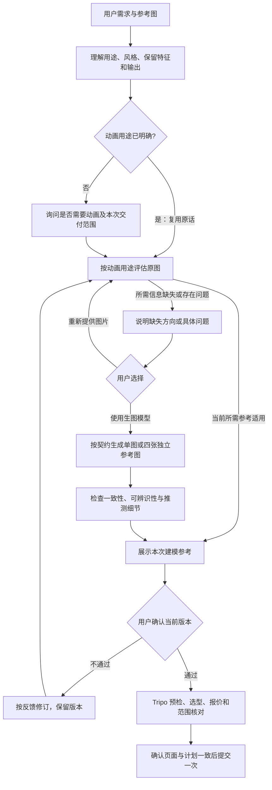

# 需求、动画用途与参考审阅

> 费用：任务范围内默认自主使用现有 Studio 积分，按项目 docs/workflow/credit-policy.md 执行，不逐次请批。参考/质量审阅、本地返工限制、未知任务对账仍保留。

协议3.6的新任务按复杂度选择参考：简单静态道具/概念可用已批准单图，角色/复杂结构/动画默认四张独立视图。旧四图契约不自动迁移。以下参考审阅顺序适用于两类输入；已下载资产的只读检查/恢复不追溯重做参考，也不新增制作范围。



## 先明确动画用途，已有答案不重复问

读取用户原话，记录到版本化 `intake-vNNN.json`，animation.status 初始 unresolved，不能把 false 或空值当作用户选择静态。

| animation.use | 含义 | 参考阶段与本次制作范围 |
|---|---|---|
| static | 用户明确只需静态模型 | 保留静态设计，不无故改成绑定姿势 |
| future_animation | 将来需要动画，本次只做适合后续绑定的模型 | 提前考虑关节、姿势与部件可分辨性，不自动制作骨架/动作 |
| rig_only | 本次需要骨架与权重，不需要动作片段 | 为绑定保留合适姿势和关节区域；不索要不必要的 clip 参数 |
| animated | 本次需要具体动作 | 明确 motion_intent；据动作幅度/接触方式考虑结构，详细时长/帧率可在需要前补齐 |

用户已经说“要跑步动画”“只要静态摆件”等就记录原话，不再问同一个问题。“游戏角色”不等于已确认需要动画；“可动”含义不明时只澄清缺失部分。未回答不能自动选择 static，也不进入参考定稿或三维付费生成；可继续分析已有图片。

intake 必需 intent、animation.status=confirmed、animation.use、animation.evidence（真实原话/已确认依据）。非 static 另填 design_implications；animated 另填 motion_intent。需求改变创建新版本并重新评估受影响参考，不复用旧哈希批准。

## 原图适用性检查

先实际查看图片，判断主体完整、清晰度、遮挡、轮廓、透视、背景、材质可辨识性、各视图一致性，以及与动画用途的适配。只指出会影响建模的信息缺口，说明具体部位、可能影响及可选解决方式。

这些是本项目的建模参考判断，不是保证高质量的“Tripo 官方统一硬指标”。当次格式、大小、张数、多视图入口和推荐姿势仍由 preflight 核对真实页面；不得硬编码所有角色必须 T pose、所有模型必须四边面、所有输入必须三视图。

原图合适：保留可用视图。简单静态/概念且信息充分可直接展示单图；采用四图路线时才补齐前/左/右/后缺失方向。复用真实有效确认。原图不合适：让用户选择重新提供，或使用生图模型按当前契约生成单图或四张独立参考图。有明确有效选择时复用，不反复询问；不能因为代理认为重绘更好就默认生图。用户坚持原设计而问题仍未解决时解释影响，不擅自把 assessment 改为 usable。

## 四张独立视图必须考虑动画用途

在调用生图前冻结 generation_brief：intake_sha256、animation_use、prompt、preserve、pose_and_separation、view_consistency、inferred_details。

- 保留身份、比例、配色、材质、标志部件和用户明确限制；不得为了绑定方便随意改变造型。
- 对蒙皮角色，按目标动作选择中性、可读的参考姿势；审查腋下、腿间、手指、脚部、尾巴、翅膀及附件的遮挡和非预期粘连。间隙以结构合理为前提，不把肩部正常连接切断。
- 对机械/刚性结构，清楚展示独立部件、铰接位置、轴向和活动间隙；不套用人体姿势。
- 需要跑跳/行走时关注腿脚和接触面；挥手关注肩肘手部；飞行关注翼根和翼面。四视图不画四个不同动作，四张应是同一结构、同一参考姿势的不同视角。
- 前、左、右、后保持尺度、姿态、部件位置和材质一致，减少透视和复杂场景干扰；防止镜像错误、缺失/多余部件和跨视图身份漂移。
- 背面及遮挡部分的补全标为推测，交用户审阅。图片清楚不证明实际生成网格已适合变形。

默认使用当前 imagegen 技能与内置生图工具，遵循会话的工具要求。Studio图像模板、Edit Image、Cutout、多视图能力按 [R01–R09](studio-capabilities.md) 评估；用户明确选择Studio路线且可执行契约和费用授权齐全时再使用，当前参考阶段收费生成的适配限制见 [配方1](studio-recipes.md)。不把未来3D参考批准伪造成现在的生图前置条件。先生成并检查，再展示；不使用 Tripo 三维生成反复试图弥补尚未解决的参考问题。只按反馈修订必要部分，使用新版本，保留上版。

角色、复杂结构及动画资产默认提交四张独立图片：`front`、`left`、`right`、`back`，分别对应Tripo前、左侧、右侧、后槽位。采用四图路线的任务在需求明确后准备完整四图；已有合格视图保留，只补缺失视图。用户已授权按需求生图时直接执行，不重复请求生图许可。没有补图授权且缺少方向时，说明缺口让用户选择提供或生成。

四图为同一主体、同一姿势、同一尺度的四个真实视角。左右侧不得用同一图重复提交或仅镜像代替，尤其核对徽章、工具、背包等不对称部件；方向按主体自身左右和当次页面槽位定义核对，不凭观看者左右猜测。此为本项目工作流要求，不声称所有Tripo模式都强制四图。

审阅可以额外制作拼版，但上传文件必须四张独立图，拼版标`qa-only`，不计入四图。由拼图拆分时检查完整主体、裁切和方向，将派生文件纳入版本及哈希；批准需覆盖最终四图。预检逐槽核对实际缩略图和文件身份，不能只记录总上传数量。

页面缺少四视图入口时先评估能支持四图的适用模式；若确实不可用，报告限制，不静默降级成单图或三图。用户明确指定单图/纯文本等例外时记录实际指令，按其范围执行。旧run恢复、下载和已有模型后处理不强制重做四图。

## 参考批准与机器检查

manifest 保留原有 files/prompt/decision，增加：

```json
{
  "intake": {"path":"intake-v001.json","sha256":"实际哈希"},
  "preparation": {
    "route":"original",
    "intake_sha256":"同一需求哈希",
    "assessment":"usable",
    "animation_considerations":"本次动画用途如何影响选图/姿势/结构",
    "checks":[{"name":"主体与动画适配","status":"pass","observation":"实际观察"}]
  },
  "decision":{"status":"pending","evidence":null}
}
```

新任务的简单静态/概念单图路线设置 `preparation.input_contract="single_image_v1"`；intake另填 `reference_profile="simple_static"|"concept"` 和 `reference_profile_reason`，animation.use必须为static，建模files恰好一张并获用户确认。复杂/角色不得只为省图而填成simple_static。其他路线设置 `preparation.input_contract="four_independent_views_v1"`。route为original、replacement、generated_single_view或generated_four_view；非original路线另有user_choice_evidence，两种generated路线另含generation_brief引用。generated_single_view仅用于满足单图契约的任务，恰好一张非qa-only输入；同样冻结上述七个generation_brief字段，保留推测细节和用户审阅，不能借此降级复杂/动画任务或旧四图契约。files中每张填写独立path/sha256及view=front|left|right|back。历史generated_three_view仅保留兼容，不作为新任务默认。纯文本仅在用户明确改变此流程时用 text_explicit，并记录选择，不自动跳过图片流程。

用户拒绝记 rejected，按反馈回到修订和展示；批准必须针对当前版本，才写 approved 和真实依据。两种 review_mode 均不能由 AI 代替用户批准参考。

`workflow.mjs check-reference` 与新 prepare 均检查动画用途、准备路线、适用性和批准；check-plan / mark submitting 进一步绑定 intake、参考哈希和页面核对证据。旧 run 的 status、对账、下载不受新提交门槛影响；旧 planned 若要新提交须补真实需求/参考资料与当前页面计划。不得为兼容而伪造历史批准。

参考确认与积分策略分开：任务范围内使用持续积分授权，不为当前报价或旧积分上限请批；不自动扩展设计任务或充值。当前检查器验证记录及身份，不能自动认证用户原话或图片美术质量。

### 提交证据字段

四图契约在参考检查中验证四个方向、四个独立路径/内容哈希；在生成提交前验证实际上传四图及各自`slot=front|left|right|back`与批准视图一致。`ui_verification.uploaded_files`逐张记录path、sha256、slot，另有逐槽观察证据。后处理任务不要求重新上传四图。机器不能判断图像是否真的画对方向，仍需人工/AI视觉核对。

scaffold为新资产写入adaptive_reference_v1到reference-contract.json和workflow-policy.reference_input_contract；单图必须满足上面的明确静态、简单/概念及已批准输入条件，否则采用四图。旧four_independent_views_v1仍强制四图，不静默迁移。漏填或换名不能避开选择检查。用户明确例外时，manifest保存preparation.input_exception={requested_by:"user",mode:"single_image|three_views|text|other_explicit",evidence:"实际原话"}。历史无契约记录保留兼容，不追溯改写旧批准。检查器对新资产的必需契约及声明四图的旧资产执行强校验；旧资产未声明时保持兼容。例外记录不能由AI推断用户批准。
